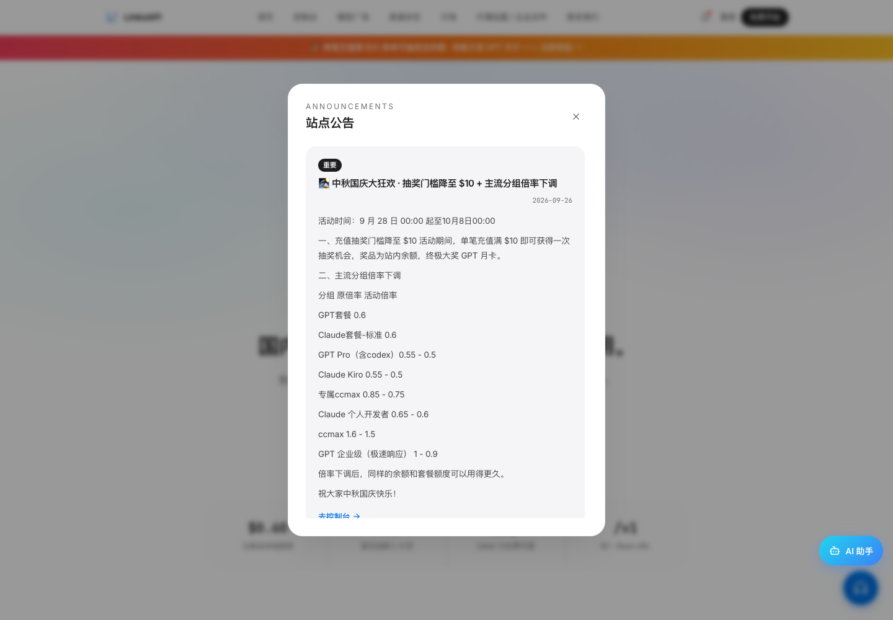
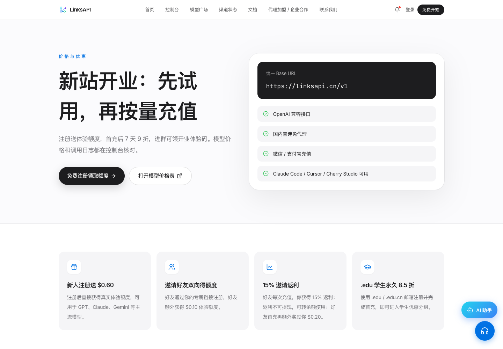
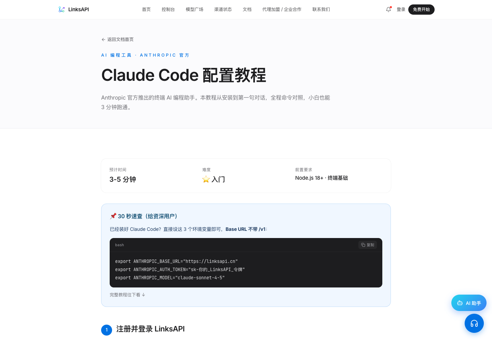

# LinksAPI Review: Trial Credit, Local Payments and Claude Code Setup

**Bottom line:** LinksAPI stands out for a short onboarding path: a $0.60 trial credit, Alipay/WeChat top-ups and separate Chinese guides for Claude Code, Codex, Cursor and Cline.

[Open LinksAPI and check the current offer](https://linksapi.cn/sign-up?aff=xvaO)

## Where LinksAPI fits

LinksAPI is easier than a documentation-light relay for first-time coding API users. Official APIs are still preferable for teams requiring direct vendor agreements.

LinksAPI is particularly relevant to developers who can use local Chinese payments or redemption codes; dollar figures below are service billing units, not card charges.

## Pricing and plan logic

Public examples list Claude Sonnet 4.5 at $4.20 input / $21 output and GPT-5.4 mini at $0.35 / $2.80 per million tokens. Use the trial credit to test connection, logs and billing before starting a top-up discount window.

For LinksAPI, test both endpoint formatting and the billed model group before deciding whether the first-top-up window is worthwhile.

## Funding the account

After login, open the wallet and choose the currently available Alipay, WeChat Pay or redemption-code option. The first top-up starts a seven-day 10% discount period, so it is better triggered after endpoint testing.

[Create an account and view the live checkout](https://linksapi.cn/sign-up?aff=xvaO)

## Claude Code, Codex and API setup

Claude Code uses `https://linksapi.cn` without `/v1`. Codex, Cline and OpenAI-compatible SDKs use `https://linksapi.cn/v1`. Mixing these two is the most common 404 cause.

On LinksAPI, use one key for the Anthropic endpoint and another for OpenAI-compatible clients to simplify 404 diagnosis.

## Recommended rollout

1. Use the $0.60 credit before starting a paid period.
2. Verify Claude Code without `/v1`.
3. Verify Codex with the `/v1` endpoint.
4. Choose the wallet payment option shown after login.
5. Start the top-up discount only when setup is complete.

## FAQ

### Is LinksAPI a replacement for an official API account?

LinksAPI can replace a bare gateway for easier onboarding, while original APIs remain preferable for direct corporate agreements.

### Should I use one key for every tool?

No. LinksAPI keys for Claude Code and Codex use different endpoint conventions and are easier to debug apart.

### Which model should I test first?

Spend the LinksAPI trial credit on a mini or lightweight coding model before starting the first paid period.

### How do I avoid unexpected spend?

For LinksAPI, set a tool-specific limit and inspect the control-panel log before the discount period drives more usage.

## Verdict

LinksAPI stands out for a short onboarding path: a $0.60 trial credit, Alipay/WeChat top-ups and separate Chinese guides for Claude Code, Codex, Cursor and Cline. LinksAPI is easier than a documentation-light relay for first-time coding API users. Official APIs are still preferable for teams requiring direct vendor agreements.

[Visit LinksAPI and compare the live pricing](https://linksapi.cn/sign-up?aff=xvaO)

Links search terms

LinksAPI review · LinksAPI pricing · LinksAPI signup · Claude Code API relay · Codex API gateway · AI API proxy

---

*Links page checked November 19, 2026; recheck the live catalog and checkout before purchase.*
